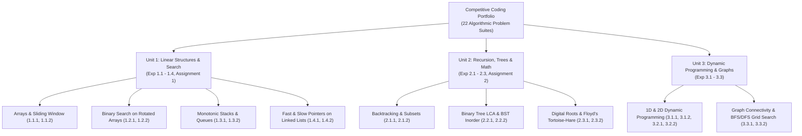

# Competitive Coding & Data Structures (5th Semester) — Code Repository

**Institution / Course:** 5th Semester Competitive Programming & Algorithmic Problem Solving (`CC`)  
**Student Profile:** Harshit Thakur | UID: 23BAI70435 | Section: 24AIT_NTPP-2A | Branch: CSE - AIML  
**Primary Language:** Python 3 (Optimized Data Structures & Asymptotic Complexity Analysis)  
**Curricular Coverage:** Arrays, Sliding Window, Binary Search, Monotonic Stacks, Fast & Slow Pointers, Backtracking, Binary Trees, Dynamic Programming & Graph Algorithms.

---

## 1. Master Curricular Map & Algorithmic Taxonomy

---

## 2. Comprehensive Problem Index & Asymptotic Analysis

### Unit 1: Linear Data Structures, Monotonic Stacks & Binary Search

| Experiment / Problem | Core Algorithmic Paradigm | Brute Force Complexity | Optimized Complexity | Verified Captures | Folder Reference |
| :--- | :--- | :---: | :---: | :---: | :--- |
| [**EXP 1.1.1: Contains Duplicate II**](file:///D:/5th%20SEM/CC/EXP%201.1.1_Contains_Duplicate-II) | Sliding Window & Hash Map | $\mathcal{O}(n \cdot k)$ | $\mathcal{O}(n) \text{ Time}, \mathcal{O}(k) \text{ Space}$ | [3 Screenshots](file:///D:/5th%20SEM/CC/EXP%201.1.1_Contains_Duplicate-II/screenshots) | [`EXP 1.1.1`](file:///D:/5th%20SEM/CC/EXP%201.1.1_Contains_Duplicate-II) |
| [**EXP 1.1.2: Product of Array Except Self**](file:///D:/5th%20SEM/CC/EXP%201.1.2_Product_of_Array_Except_Self) | Prefix & Suffix Product Accumulation | $\mathcal{O}(n^2)$ | $\mathcal{O}(n) \text{ Time}, \mathcal{O}(1) \text{ Space}$ | [3 Screenshots](file:///D:/5th%20SEM/CC/EXP%201.1.2_Product_of_Array_Except_Self/screenshots) | [`EXP 1.1.2`](file:///D:/5th%20SEM/CC/EXP%201.1.2_Product_of_Array_Except_Self) |
| [**Exp 1.2.1: LeetCode 35 Search Insert**](file:///D:/5th%20SEM/CC/Exp%201.2.1_LeetCode35) | Binary Search Boundary Convergence | $\mathcal{O}(n)$ | $\mathcal{O}(\log n) \text{ Time}, \mathcal{O}(1) \text{ Space}$ | [3 Screenshots](file:///D:/5th%20SEM/CC/Exp%201.2.1_LeetCode35/Screenshots) | [`Exp 1.2.1`](file:///D:/5th%20SEM/CC/Exp%201.2.1_LeetCode35) |
| [**Exp 1.2.2: Search in Rotated Sorted Array**](file:///D:/5th%20SEM/CC/Exp%201.2.2_Search_Rotated_Array) | Modified Binary Search on Pivoted Array | $\mathcal{O}(n)$ | $\mathcal{O}(\log n) \text{ Time}, \mathcal{O}(1) \text{ Space}$ | [2 Screenshots](file:///D:/5th%20SEM/CC/Exp%201.2.2_Search_Rotated_Array/screenshots) | [`Exp 1.2.2`](file:///D:/5th%20SEM/CC/Exp%201.2.2_Search_Rotated_Array) |
| [**Exp 1.3.1: Queue Using Stack**](file:///D:/5th%20SEM/CC/Exp%201.3.1_queue_using_stack) | Dual-Stack Amortized Transfer | $\mathcal{O}(n) \text{ Push}$ | $\mathcal{O}(1) \text{ Amortized Pop/Peek}$ | [4 Screenshots](file:///D:/5th%20SEM/CC/Exp%201.3.1_queue_using_stack/Screenshots) | [`Exp 1.3.1`](file:///D:/5th%20SEM/CC/Exp%201.3.1_queue_using_stack) |
| [**Exp 1.3.2: Largest Rectangle in Histogram**](file:///D:/5th%20SEM/CC/Exp%201.3.2_Largest_Rectangle_Histogram) | Monotonic Increasing Stack | $\mathcal{O}(n^2)$ | $\mathcal{O}(n) \text{ Time}, \mathcal{O}(n) \text{ Space}$ | [2 Screenshots](file:///D:/5th%20SEM/CC/Exp%201.3.2_Largest_Rectangle_Histogram/Screenshots) | [`Exp 1.3.2`](file:///D:/5th%20SEM/CC/Exp%201.3.2_Largest_Rectangle_Histogram) |
| [**Exp 1.4.1: Palindrome Linked List**](file:///D:/5th%20SEM/CC/Exp%201.4.1_Palindrome_Linked_List) | Fast & Slow Pointer + In-Place Reverse | $\mathcal{O}(n) \text{ Space}$ | $\mathcal{O}(n) \text{ Time}, \mathcal{O}(1) \text{ Space}$ | [2 Screenshots](file:///D:/5th%20SEM/CC/Exp%201.4.1_Palindrome_Linked_List/screenshots) | [`Exp 1.4.1`](file:///D:/5th%20SEM/CC/Exp%201.4.1_Palindrome_Linked_List) |
| [**Exp 1.4.2: Odd Even Linked List**](file:///D:/5th%20SEM/CC/Exp%201.4.2_odd_even_linked_list) | In-Place Two-Pointer Partitioning | $\mathcal{O}(n) \text{ Space}$ | $\mathcal{O}(n) \text{ Time}, \mathcal{O}(1) \text{ Space}$ | [2 Screenshots](file:///D:/5th%20SEM/CC/Exp%201.4.2_odd_even_linked_list/screenshots) | [`Exp 1.4.2`](file:///D:/5th%20SEM/CC/Exp%201.4.2_odd_even_linked_list) |
| [**Assignment 1: Rotated Array Search**](file:///D:/5th%20SEM/CC/Assignment-1) | Boundary Invariant Binary Partitioning | $\mathcal{O}(n)$ | $\mathcal{O}(\log n) \text{ Time}, \mathcal{O}(1) \text{ Space}$ | [2 Screenshots](file:///D:/5th%20SEM/CC/Assignment-1/Screenshots) | [`Assignment-1`](file:///D:/5th%20SEM/CC/Assignment-1) |

---

### Unit 2: Recursion, Backtracking, Trees & Number Theory

| Experiment / Problem | Core Algorithmic Paradigm | Brute Force Complexity | Optimized Complexity | Verified Captures | Folder Reference |
| :--- | :--- | :---: | :---: | :---: | :--- |
| [**EXP 2.1.1: Subsets Problem**](file:///D:/5th%20SEM/CC/EXP%202.1.1_Subsets_problem) | Cascading Backtracking & Bitmasking | $\mathcal{O}(2^n \cdot n)$ | $\mathcal{O}(2^n) \text{ Optimal State Space}$ | [2 Screenshots](file:///D:/5th%20SEM/CC/EXP%202.1.1_Subsets_problem/screenshots) | [`EXP 2.1.1`](file:///D:/5th%20SEM/CC/EXP%202.1.1_Subsets_problem) |
| [**Exp 2.1.2: Combination Sum**](file:///D:/5th%20SEM/CC/Exp%202.1.2_Combination_Sum) | Backtracking with Pruning & Reuse | $\mathcal{O}(2^t)$ | $\mathcal{O}(k \cdot 2^t) \text{ with Target Pruning}$ | [2 Screenshots](file:///D:/5th%20SEM/CC/Exp%202.1.2_Combination_Sum/screenshots) | [`Exp 2.1.2`](file:///D:/5th%20SEM/CC/Exp%202.1.2_Combination_Sum) |
| [**Exp 2.2.1: Lowest Common Ancestor**](file:///D:/5th%20SEM/CC/Exp%202.2.1_LCA_Binary_Tree) | Post-Order Recursive Tree Traversal | $\mathcal{O}(n) \text{ Path Storing}$ | $\mathcal{O}(n) \text{ Time}, \mathcal{O}(h) \text{ Stack}$ | [2 Screenshots](file:///D:/5th%20SEM/CC/Exp%202.2.1_LCA_Binary_Tree/screenshots) | [`Exp 2.2.1`](file:///D:/5th%20SEM/CC/Exp%202.2.1_LCA_Binary_Tree) |
| [**Exp 2.2.2: Inorder Successor in BST**](file:///D:/5th%20SEM/CC/Exp%202.2.2_Inorder_successor_BST) | Binary Search Tree Invariant Pruning | $\mathcal{O}(n) \text{ Traversal}$ | $\mathcal{O}(h) \text{ Time}, \mathcal{O}(1) \text{ Space}$ | [2 Screenshots](file:///D:/5th%20SEM/CC/Exp%202.2.2_Inorder_successor_BST/screenshots) | [`Exp 2.2.2`](file:///D:/5th%20SEM/CC/Exp%202.2.2_Inorder_successor_BST) |
| [**Exp 2.3.1: Add Digits (Digital Root)**](file:///D:/5th%20SEM/CC/Exp%202.3.1_Add_Digits) | Congruence Formula (Modulo 9 Math) | $\mathcal{O}(\log n) \text{ Loop}$ | $\mathcal{O}(1) \text{ Time}, \mathcal{O}(1) \text{ Space}$ | [2 Screenshots](file:///D:/5th%20SEM/CC/Exp%202.3.1_Add_Digits/screenshots) | [`Exp 2.3.1`](file:///D:/5th%20SEM/CC/Exp%202.3.1_Add_Digits) |
| [**Exp 2.3.2: Find Duplicate Number**](file:///D:/5th%20SEM/CC/Exp%202.3.2_Find_the_Duplicate_Number) | Floyd's Tortoise & Hare Cycle Detection | $\mathcal{O}(n \log n) \text{ Sort}$ | $\mathcal{O}(n) \text{ Time}, \mathcal{O}(1) \text{ Space}$ | [2 Screenshots](file:///D:/5th%20SEM/CC/Exp%202.3.2_Find_the_Duplicate_Number/screenshots) | [`Exp 2.3.2`](file:///D:/5th%20SEM/CC/Exp%202.3.2_Find_the_Duplicate_Number) |
| [**Assignment 2: Linked List Cycle Detection**](file:///D:/5th%20SEM/CC/Assignment-2) | Fast/Slow Pointers & Cycle Start Pointer | $\mathcal{O}(n) \text{ Hash Set}$ | $\mathcal{O}(n) \text{ Time}, \mathcal{O}(1) \text{ Space}$ | [3 Screenshots](file:///D:/5th%20SEM/CC/Assignment-2/screenshots) | [`Assignment-2`](file:///D:/5th%20SEM/CC/Assignment-2) |

---

### Unit 3: Dynamic Programming & Graph Algorithms

| Experiment / Problem | Core Algorithmic Paradigm | Brute Force Complexity | Optimized Complexity | Verified Captures | Folder Reference |
| :--- | :--- | :---: | :---: | :---: | :--- |
| [**Exp 3.1.1: Climbing Stairs**](file:///D:/5th%20SEM/CC/Exp%203.1.1_climbing_Stairs) | 1D Dynamic Programming Tabulation | $\mathcal{O}(2^n) \text{ Recursion}$ | $\mathcal{O}(n) \text{ Time}, \mathcal{O}(1) \text{ Space}$ | [2 Screenshots](file:///D:/5th%20SEM/CC/Exp%203.1.1_climbing_Stairs/screenshots) | [`Exp 3.1.1`](file:///D:/5th%20SEM/CC/Exp%203.1.1_climbing_Stairs) |
| [**Exp 3.1.2: Frog Jump with K Distance**](file:///D:/5th%20SEM/CC/Exp%203.1.2_Frog_Jump_with_K_Distance) | Linear DP with Window Transition | $\mathcal{O}(k^n)$ | $\mathcal{O}(n \cdot k) \text{ Time}, \mathcal{O}(n) \text{ Space}$ | [2 Screenshots](file:///D:/5th%20SEM/CC/Exp%203.1.2_Frog_Jump_with_K_Distance/screenshots) | [`Exp 3.1.2`](file:///D:/5th%20SEM/CC/Exp%203.1.2_Frog_Jump_with_K_Distance) |
| [**Exp 3.2.1: Coin Change**](file:///D:/5th%20SEM/CC/Exp%203.2.1_coin_chnage) | Unbounded Knapsack Tabulation | $\mathcal{O}(S^n)$ | $\mathcal{O}(n \cdot \text{amount}) \text{ Time}, \mathcal{O}(\text{amount}) \text{ Space}$ | [2 Screenshots](file:///D:/5th%20SEM/CC/Exp%203.2.1_coin_chnage/screenshots) | [`Exp 3.2.1`](file:///D:/5th%20SEM/CC/Exp%203.2.1_coin_chnage) |
| [**Exp 3.2.2: Longest Common Subsequence**](file:///D:/5th%20SEM/CC/Exp%203.2.2_Longest_Common_Subsequence) | 2D Tabulation DP Grid | $\mathcal{O}(2^{m+n})$ | $\mathcal{O}(m \cdot n) \text{ Time}, \mathcal{O}(m \cdot n) \text{ Space}$ | [2 Screenshots](file:///D:/5th%20SEM/CC/Exp%203.2.2_Longest_Common_Subsequence/screenshots) | [`Exp 3.2.2`](file:///D:/5th%20SEM/CC/Exp%203.2.2_Longest_Common_Subsequence) |
| [**Exp 3.3.1: Path Exists in Graph**](file:///D:/5th%20SEM/CC/Exp%203.3.1_Find_if_Path_Exists_in_Graph) | BFS Queue / Disjoint Set Union (DSU) | $\mathcal{O}(V!)$ | $\mathcal{O}(V + E) \text{ Time}, \mathcal{O}(V) \text{ Space}$ | [2 Screenshots](file:///D:/5th%20SEM/CC/Exp%203.3.1_Find_if_Path_Exists_in_Graph/screenshots) | [`Exp 3.3.1`](file:///D:/5th%20SEM/CC/Exp%203.3.1_Find_if_Path_Exists_in_Graph) |
| [**Exp 3.3.2: Number of Islands**](file:///D:/5th%20SEM/CC/Exp%203.3.2_Number_of_Islands) | 2D Matrix Connected Component DFS/BFS | $\mathcal{O}((m \cdot n)^2)$ | $\mathcal{O}(m \cdot n) \text{ Time}, \mathcal{O}(m \cdot n) \text{ Space}$ | [2 Screenshots](file:///D:/5th%20SEM/CC/Exp%203.3.2_Number_of_Islands/Screenshots) | [`Exp 3.3.2`](file:///D:/5th%20SEM/CC/Exp%203.3.2_Number_of_Islands) |

---

## 3. Repository Summary

- **Total Problem Suites:** 22 Modules (20 Core Experiments + 2 Major Assignments)
- **Implementations:** Every folder contains both standard baseline/brute-force code and asymptotically optimal solutions.
- **Verification:** All 22 modules include verified LeetCode runtime acceptance captures in their respective `screenshots/` folders.
